# Frame Graphs

**Subtitle:** A practical and complete conceptual model for interoperable reference frame specifications.
**Document type:** Research paper  
**Status:** In-progress background paper; reference for normative GeoPose 1.1 standard  
**Target length:** Approximately 35 pages of main text, suitable for journal publication  
**Author(s):**  Smyth  
**Affiliation(s):** [To be completed]  
**Version/date:** Draft 0.31 — October 2026

> **Note:** Each subsection has some placeholder text.  I am replacing these as the manuscript develops. 

## Abstract

An observer in physical space may record (proper) time and three orthogonal measures of distance in a local reference frame. The observer's local frame has a defining origin and an orientation. The pose concept, taken from computer graphics and mirroring everyday human visual perception, can be shown to work rigorously as a means to specify any such local Euclidean frame embedded in our most general conception of physical space and time: the pseudo-Riemannian manifold. A local Euclidean frame is always possible for any time and 3-space origin, even though the relationship between local frames may involve the full complexity of curved spacetime. When a local frame is related to a standard frame defined by arbitrary convention, such as earth or celestial reference frames, the existence of this relationship may be denoted by linking the frames. This paper details the mathematical foundation of a frame graph and its extension across space, time, and spacetime.

In addition to a structure that supports interoperable exchange of reference frame specifications,  three additional aspects of frame data exchange are described:

- **uncertainty**: bias, resolution, error, and belief
- **transformation**: the steps and external resources needed to locate and orient one local frame with another
- **components** that can be combined to represent a frame graph.

The result is a frame graph representation that works for all physical spaces.

## Keywords

conceptual model; origin, orientation, local reference frame; Riemannian manifold, differential geometry; spatial computing; geodesy; spacetime; uncertainty; bias; resolution; error; belief;  interoperability.

## 1. Introduction

### 1.1 Motivation and problem statement

There is a need for a simple, interoperable description of local position and orientation that can be used in terrestrial, visual-positioning, and astronomical contexts without embedding transformation algorithms or parameters in the representation.

Different expressions of the pose concept as the basis for frame specification are used in may spatial applications. Although the underlying concepts may be the same, the expression in different forms works against interoperability. Further, the applicability of a local Euclidean pose specification in frames across domains involving dynamic reference frame relationships.

Differential geometry provides a framework for understanding how a locally Euclidean concept, the pose of computer graphics, can meet this need without serious modification. The only extra information that may be needed is the proper time at the origin of the pose, and linkage to one of three externally defined standard reference frames. This paper demonstrates how the precise relationship to generalised physical space makes the model applicable to any local frame definition in the Universe.

### 1.2 Objectives and questions

**TBD** State the questions addressed: what a frame graph specifies; which geometric structures make it meaningful; how a local spatial frame can be situated in broader physical geometry; and what information is needed to compare frames.

*Content goes here.*

### 1.3 Central principle

The linked frame model encapsulates the specification of a three-dimensional local spatial reference frame, expressed relative to one of three designated standard The linked framereference frames. The local representation is independent of geometry-dependent relations and transformations between frames.

A local spatial reference frame, consists of a position and an orientation. A linked frame has a transformation to another reference frame. A floating frame has no linking transformation.

The concept is independent of the global geometry of the space or spacetime in which the frame is defined. It is applicable to Euclidean space, curved spatial manifolds, and physical spacetime modeled using special or general relativity.

The mathematical foundation for this generality is differential geometry. A smooth manifold provides a locally Euclidean coordinate structure, while its tangent spaces provide the setting for defining local spatial frames. Metrics, connections, and transformations provide the additional mathematical structures needed to establish geometric relationships between frames.

A linked frame can retain a simple local representation while participating in geometric configurations extending across arbitrary spatial and temporal scales and relative velocities, provided that the necessary geometric and physical structures are specified.

This approach does not introduce a new theory of space or time. Rather, it places the linked frame concept within established mathematical treatments of space, time, and spacetime, using local reference frames as the common foundation for representing position and orientation.

*Content goes here.*

### 1.4 Claimed contributions and scope

**TBD** Identify contributions to be tested against prior work. Explicitly delimit the six-degree-of-freedom local spatial concept, the general mathematical setting, and out-of-scope transformation specifications.

*Content goes here.*

### 1.5 Organization of the paper

**TBD** Give a short reader's guide to Sections 2–11.

*Content goes here.*

## 2. Prior Work and Standards Context

### 2.1 OGC GeoPose 1.0 and proposed GeoPose 1.1

**TBD** Summarize existing definitions and representations. Specify precisely which elements are retained, clarified, generalized, or newly proposed. Mostl proposed changes are not novel but rather reflect refactoring or repackaging. The primary new elements are the background within which Geo{oseor linked rference frames can be used across all of the pseudo-Riemannan spaces relevant to the physical universe.

*Content goes here.*

### 2.2 Geospatial referencing and ISO/OGC standards

**TBD** Review coordinate reference systems, datums, reference frames, coordinate operations, temporal referencing, and quality. Examine ISO 19111 and other relevant standards with verified editions and citations.

*Content goes here.*

### 2.3 Rigid-body pose in robotics, graphics, and spatial computing

### The 3D Special Euclidean Lie Group SE(3)

The special Euclidean Lie Group SE(3)f 3D describes rigid-body motions (rotations and translations).

#### 2.3.1. Geometric Meaning

SE(3) is the set of all rigid-body transformations in three-dimensional space: rotations and translations.

A transformation \(T\in SE(3)\) maps points expressed in one Cartesian frame to points expressed in another. A rigid transformation preserves distances and angles.

  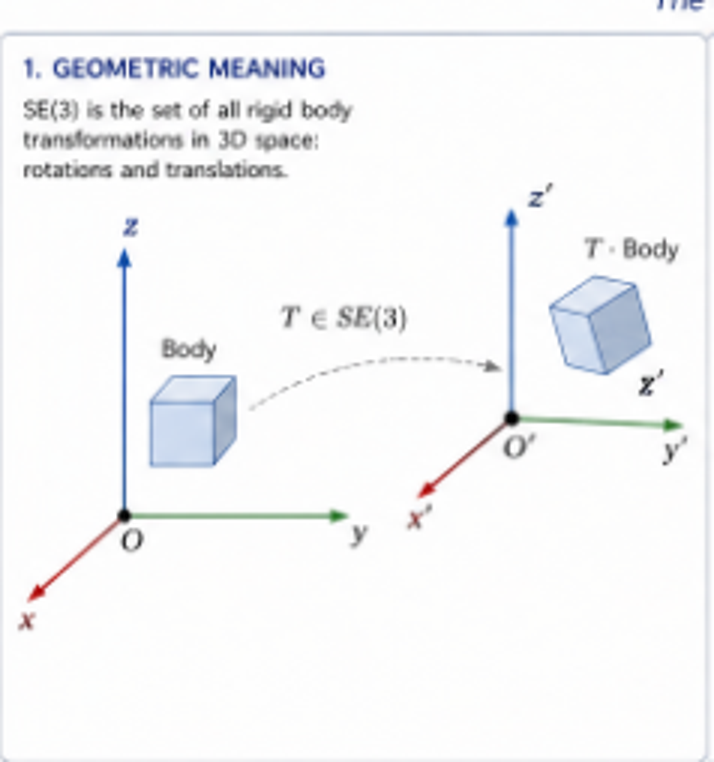

*Figure 1. REPLACE WITH NEW FIG A body is moved from an initial coordinate frame to a translated and rotated frame.*

#### 2.3.2. Matrix Representation

Each element \(T\in SE(3)\) can be written as a \(4\times4\) homogeneous transformation matrix:

$$
T=\begin{bmatrix}R&t\\\mathbf{0}_{1\times3}&1\end{bmatrix}
$$

where:

- \(R\in SO(3)\) is a rotation matrix, satisfying \(R^TR=I\) and \(\det R=1\).
- \(t\in\mathbb{R}^3\) is a translation vector.
- \(\mathbf{0}_{1\times3}=[0\;0\;0]\).

##### Example: Rotation about the Z-axis

$$
R=R_z(\theta)=\begin{bmatrix}
\cos\theta&-\sin\theta&0\\
\sin\theta&\cos\theta&0\\
0&0&1
\end{bmatrix},\qquad
 t=\begin{bmatrix}t_x\\t_y\\t_z\end{bmatrix}.
$$

##### Numerical example

For \(\theta=30^\circ\) and \(t=[1\;2\;3]^T\),

$$
T\approx\begin{bmatrix}
0.866&-0.500&0&1\\
0.500&0.866&0&2\\
0&0&1&3\\
0&0&0&1
\end{bmatrix}.
$$

#### 2.3.3. Group Properties

The transformations in SE(3) form a group under matrix multiplication.

##### Closure

If \(T_1,T_2\in SE(3)\), then \(T_1T_2\in SE(3)\).

##### Identity

$$
I_4=\begin{bmatrix}I_3&0\\0&1\end{bmatrix}.
$$

##### Inverse

For \(T=\begin{bmatrix}R&t\\0&1\end{bmatrix}\),

$$
T^{-1}=\begin{bmatrix}R^T&-R^Tt\\0&1\end{bmatrix}.
$$

##### Composition (concatenation)

If

$$
T_1=\begin{bmatrix}R_1&t_1\\0&1\end{bmatrix},\quad
T_2=\begin{bmatrix}R_2&t_2\\0&1\end{bmatrix},
$$

then

$$
T_1T_2=\begin{bmatrix}R_1R_2&R_1t_2+t_1\\0&1\end{bmatrix}.
$$

With the column-vector convention used here, \(T_1T_2\) applies \(T_2\) first and then \(T_1\).

  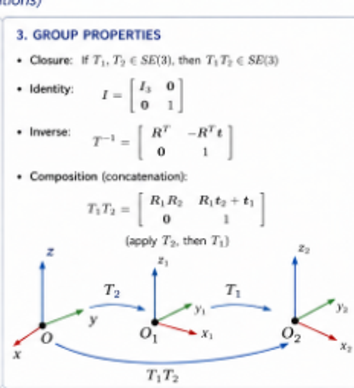

*Figure 2. REPLACE WITH NEW FIG Composition of rigid transformations. Frame labels and composition order must follow a consistent convention.*

#### 2.3.4. Lie Group Structure

SE(3) is a six-dimensional smooth manifold and a Lie group. Its Lie algebra \(\mathfrak{se}(3)\), the tangent space at the identity, consists of twists \(\xi\in\mathbb{R}^6\) written as

$$
\xi=\begin{bmatrix}\rho\\\phi\end{bmatrix},\qquad
\rho,\phi\in\mathbb{R}^3.
$$

The associated matrix representation (the **hat** operator) is

$$
\widehat{\xi}=\begin{bmatrix}
[\phi]_\times&\rho\\
\mathbf{0}_{1\times3}&0
\end{bmatrix}\in\mathfrak{se}(3),
$$

where

$$
[\phi]_\times=\begin{bmatrix}
0&-\phi_z&\phi_y\\
\phi_z&0&-\phi_x\\
-\phi_y&\phi_x&0
\end{bmatrix}.
$$

The dimension is

$$
\dim SE(3)=6\qquad\text{(3 rotational + 3 translational degrees of freedom).}
$$

#### 2.3.5. Exponential Map

The exponential map maps a twist \(\xi\in\mathfrak{se}(3)\) to a rigid transformation \(T\in SE(3)\):

$$
T=\exp(\widehat{\xi})=
\begin{bmatrix}
\exp([\phi]_\times)&J(\phi)\rho\\
0&1
\end{bmatrix},
$$

where \(R=\exp([\phi]_\times)\in SO(3)\) and \(J(\phi)\) is the left Jacobian of SO(3).

For small \(\|\phi\|\),  the infographic gives the series approximation

$$
J(\phi)\approx I+\frac12[\phi]_\times+\frac16[\phi]_\times^2.
$$

  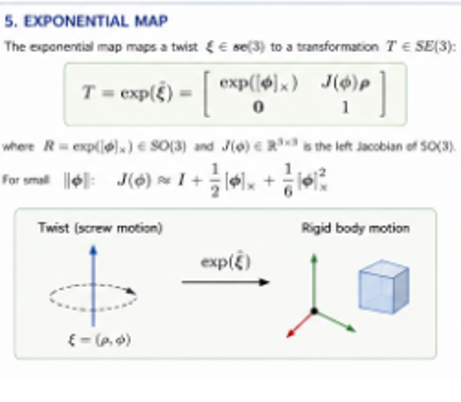

*Figure 3. REPLACE WITH NEW FIG The exponential map associates a twist with a rigid-body transformation.*

#### 2.3.6. Applications

SE(3) is used in:

- **Robotics:** End-effector pose and kinematics.
- **Computer vision:** Camera pose, simultaneous localization and mapping (SLAM), and visual positioning.
- **State estimation:** Estimation and optimization on manifolds.
- **Rigid-body registration and calibration:** Alignment of objects, sensors, and coordinate frames.

##### Summary

$$
SE(3)=\left\{\begin{bmatrix}R&t\\0&1\end{bmatrix}\;\middle|\;R\in SO(3),\ t\in\mathbb{R}^3\right\}.
$$

SE(3) is the mathematical backbone of three-dimensional pose representation and rigid-body motion.

##### Relevance to linked frames

SE(3) provides a natural mathematical representation for the six-degree-of-freedom relationship between two Euclidean spatial frames. For the proposed GeoPose conceptual model, this representation is particularly appropriate within a local tangent space or another specified Euclidean spatial region. Relating such frames across a curved manifold may require additional geometric structures and transformation procedures external to the linked frame representation.

---

### 2.4 Reference systems in geodesy and astronomy

**TBD** Introduce ITRF2020, WGS 84 realizations, ICRS/ICRF, and BCRS. Distinguish systems, frames, realizations, coordinate systems, and epochs.

#### 2.4.1. WGS84 G2296 Geodetic Reference System

*Official realization of WGS 84 (G2296) as defined by the National Geospatial-Intelligence Agency (NGA).*

A precise, global, Earth-centered reference system for position, navigation, and timing.

##### 2.4.1.1. Overview

- WGS84 G2296 is the current official realization of the WGS 84 geodetic reference system.
- It defines the origin, scale, orientation, and gravity-related quantities consistent with global positioning systems (GPS).
- It is used worldwide for navigation, surveying, mapping, and geodesy.

##### 2.4.1.2. Reference Frame (G2296)

- **Type:** Earth-centered, Earth-fixed (ECEF).
- **Origin:** Earth's center of mass (geocenter).
- **Orientation:** Aligned with the International Terrestrial Reference Frame (ITRF).
- **Scale:** Consistent with the SI meter.
- **Realization epoch:** 2017.0
- **Time scale:** Coordinated Universal Time (UTC)
- **Updated and maintained by:** NGA.

##### 2.4.1.3. WGS84 Ellipsoid (G2296)

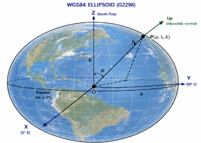

The reference ellipsoid defines the shape used for geodetic latitude, longitude, and ellipsoidal height.

| Parameter | Symbol | Value shown in image |
|---|---|---|
| Semi-major axis | $a$ | 6,378,137.0 m |
| Flattening | $f$ | $1/298.257223563$ |
| Semi-minor axis | $b$ | 6,356,752.314245 m |
| First eccentricity squared | $e^2$ | approximately 0.00669437999014 |
| Second eccentricity squared | $e'^2$ | approximately 0.00673949674228 |

The diagram shows the geocenter $O$, ellipsoid semi-axes $a$ and $b$, and a point $P(\phi,\lambda,h)$ above the reference ellipsoid. The **Up** direction follows the ellipsoid normal at the reference position.

##### 2.4.1.4. Geodetic Coordinates

A position on or near Earth is specified by:

- $\phi$: geodetic latitude, from $-90^\circ$ to $+90^\circ$.
- $\lambda$: geodetic longitude, from $-180^\circ$ to $+180^\circ$.
- $h$: ellipsoidal height, in meters.

The ellipsoidal normal (**Up**) is perpendicular to the ellipsoid at the geodetic point.

##### 2.4.1.5. Earth-Centered, Earth-Fixed Cartesian Coordinate System

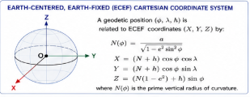

A geodetic position $(\phi,\lambda,h)$ is converted to ECEF Cartesian coordinates $(X,Y,Z)$ by:

$$
N(\phi)=\frac{a}{\sqrt{1-e^2\sin^2\phi}}
$$

$$
X=(N(\phi)+h)\cos\phi\cos\lambda
$$

$$
Y=(N(\phi)+h)\cos\phi\sin\lambda
$$

$$
Z=(N(\phi)(1-e^2)+h)\sin\phi
$$

where $N(\phi)$ is the prime vertical radius of curvature, $a$ is the ellipsoid semi-major axis, and $e^2$ is the first eccentricity squared.

##### 2.4.1.6. Local Topocentric (ENU) Coordinate System

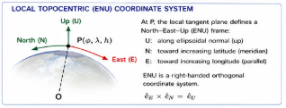

At a selected geodetic position $P(\phi_0,\lambda_0,h_0)$, define a local **East–North–Up (ENU)** Cartesian frame:

- **Up (U):** Along the ellipsoidal normal, outward.
- **North (N):** Tangent to the meridian in the direction of increasing latitude.
- **East (E):** Tangent to the parallel in the direction of increasing longitude.

The ENU frame is right-handed:

$$\hat{\mathbf e}_E\times\hat{\mathbf e}_N=\hat{\mathbf e}_U.$$

This local frame is useful for representing a frame relative to a terrestrial reference position, usually identified by a physical marker.

##### 2.4.1.7. Relationship to ITRF2020

WGS84 G2296 is aligned with the International Terrestrial Reference Frame 2020 (ITRF2020).

**NOTE** There are specific dates that correspond to the WGS83 realizations of ITRF2020. There needs to be a final scrub of the dates and id numbers to make certain they are all consistent.

It describes the origin, orientation, and scale of WGS84 G2296 as consistent with ITRF2020 at the stated realization epoch, and gives a schematic epoch-dependent relation:

$$
\mathbf X_{\mathrm{WGS84}}(t)
\approx
\mathbf X_{\mathrm{ITRF2020}}(t_0)
+\mathbf V\,(t-t_0)
$$

where $\mathbf V$ is a station or point velocity and $t_0$ is a reference epoch. This is a simplified relation from the infographic, **not** a complete transformation specification. The image also refers readers to NGA STND 0036 for details.

 **TBD**  Verify the exact realization epoch, alignment accuracy, and reference-frame transformation details against authoritative NGA/ITRF documentation before publication.

##### 2.4.1.8. WGS84 G2296 Parameters Summary

| Parameter | Value shown or described |
|---|---|
| Reference system | WGS 84 (G2296) |
| Origin | Earth's center of mass |
| Reference frame | ITRF-compatible |
| Epoch | 2017.0 (source label; verify) |
| Scale | SI meter |
| Semi-major axis, $a$ | 6,378,137.0 m |
| Flattening, $f$ | $1/298.257223563$ |
| Gravity-related parameters | Included in original infographic; verify precise small-print values against NGA specification |
| Realization authority | NGA |
| Official name | WGS84 G2296 |

##### 2.4.1.9. Summary

- WGS84 G2296 is an official realization of the WGS 84 geodetic reference system.
- It is Earth-centered, Earth-fixed, and aligned with ITRF2020.
- The WGS84 ellipsoid defines the reference shape for geodetic latitude, longitude, and ellipsoidal height.
- Positions can be expressed using geodetic $(\phi,\lambda,h)$ or Cartesian $(X,Y,Z)$ coordinates.
- A local East–North–Up reference frame can be constructed at a selected geodetic point.
- WGS84 is widely used in GPS and global geospatial applications.

##### 2.4.1.10. Relevance to the linked frame Conceptual Model

A single terrestrial reference system supports several coordinate representations and a locally defined spatial frame. In the linked frame conceptual model, the LTP-ENU frame provides an example of a local Euclidean frame whose origin and orientation are specified relative to a larger, externally defined terrestrial frame.

The coordinate conversions and transformations are separate mathematical operations; they are not defined by the linked frame representation itself.

#### 2.4.2. International Terrestrial Reference Frame (ITRF)

#### 2.4.2.1. Overview

| Concept | Center / Origin | Definition Type | Primary Function |
| :--- | :--- | :--- | :--- |
| BCRS | Solar System Barycenter | Theoretical & Relativistic  (Metric)| Models gravity, time, and light trajectories in the Solar System  |
| ICRF| Solar System Barycenter | Theoretical & Relativistic (Metric) | Provides a fixed, non-rotating physical reference frame using quasars. |

 ITRF is based on the precise measurement of the location of each of more than 1,800 reference stations on the Earth's surface. In addition to a position at the time of measurement, each station has an estimated velocity vector giving the speed and direction of motion of the station with respect to the underlying geodetic model. These velocities directly reflect the continuous drift of tectonic plates—typically moving at rates of about 1 to 10 centimeters per year. A practical consequence is that a position should include a time in order to account for crustal motion. The ITRF position of a physical marker on the Earth's surface will change over time.

There are plate boundary and plate motion models based on the reference station positions and velocities, but these derived products do not affect the positions referencing the ITRF model.

#### 2.4.3. Barycentric Coordinate Reference System

#### 2.4.3.1. Overview

BCRS (The Mathematical System): BCRS is a relativistic, four-dimensional spacetime coordinate system centered at the Solar System Barycenter. It defines the fundamental physics, metric tensors, and time scales (like Barycentric Coordinate Time, TCB) dictated by the International Astronomical Union (IAU).

The Barycentric Celestial Reference System (BCRS) is a relativistic reference system centered at the center of mass (barycenter) of the Solar System. It is defined within the framework of General Relativity and is kinematically non-rotating with respect to distant extragalactic objects. The BCRS provides the fundamental coordinate system for modeling the motion of celestial bodies within the Solar System.

In geodesy, the BCRS is essential for high-precision modeling of satellite dynamics, planetary ephemerides, and Very Long Baseline Interferometry (VLBI) observations. It forms the theoretical foundation for linking celestial and terrestrial reference systems and ensures consistency in the treatment of relativistic effects in Earth rotation, time scales, and space-geodetic observations.

#### 2.4.4. International Celestial Reference Frame

*Fundamental celestial reference system adopted by the International Astronomical Union (IAU) in 1998.*

#### 2.4.4.1. Overview

The **International Celestial Reference System (ICRS)** is a quasi-inertial celestial reference system realized by extragalactic radio sources whose positions and proper motions are effectively fixed by their great distances. It has a well-defined relationship to both the ITRF amd BCRS frames.

The ICRS provides a stable, fundamental reference for modern astrometry, spacecraft navigation, and geodesy.

#### 2.4.4.2. Key features

| Property | Description |
|---|---|
| Origin | Barycenter of the Solar System, consistent with the Barycentric Celestial Reference System (BCRS) |
| Orientation | Defined by distant extragalactic radio sources; approximately aligned with the BCRS axes at epoch J2000.0 |
| Nature | Quasi-inertial; non-rotating with respect to distant extragalactic objects |
| Realization | International Celestial Reference Frame (ICRF) |
| Time scale | Barycentric Coordinate Time (TCB) |
| Uses | Precise astrometry, spacecraft navigation, and geodesy |

#### 2.4.4.3. Coordinate system and axes

The ICRS uses a right-handed Cartesian coordinate system with origin at the Solar System barycenter and axes approximately aligned with those of the BCRS at J2000.0.

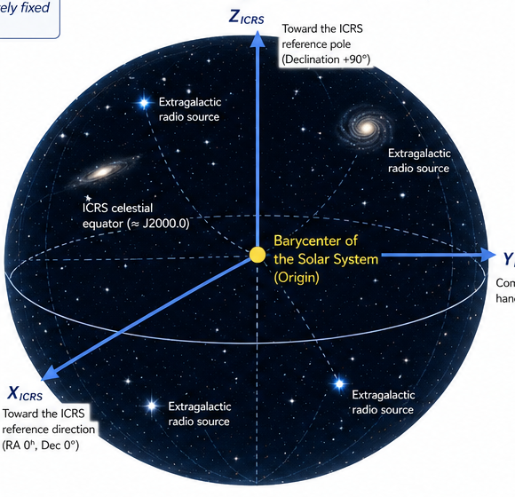

*Figure 1. ICRS axes, Solar System barycenter, celestial equator, and extragalactic reference sources.*

- **X axis:** Toward the ICRS reference direction at right ascension (RA) 0°, declination (Dec) 0°.
- **Y axis:** Completes the right-handed system.
- **Z axis:** Toward the ICRS reference pole, declination +90°.

The ICRS axes are approximately aligned with the BCRS axes at J2000.0.

#### 2.4.4.4. Spherical celestial coordinates

A direction or location can be described using spherical coordinates:

- **Right ascension (α):** Angular coordinate along the celestial equator from the reference direction.
- **Declination (δ):** Angle north (+) or south (−) of the equatorial plane.
- **Distance (r):** Radial distance from the origin, when applicable.

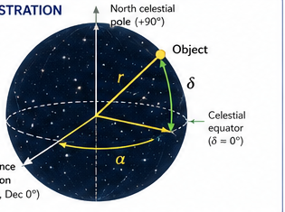

*Figure 2. Celestial sphere illustration showing right ascension α, declination δ, and distance r.*

For a point with finite distance, the corresponding Cartesian coordinates may be expressed as:

$$
\begin{aligned}
X &= r\cos\delta\cos\alpha,\\
Y &= r\cos\delta\sin\alpha,\\
Z &= r\sin\delta.
\end{aligned}
$$

#### 2.4.4.5. Realization: International Celestial Reference Frame (ICRF)

The **ICRF** is the realization of the ICRS through a catalog of compact extragalactic radio sources observed using **Very Long Baseline Interferometry (VLBI)**.

The supplied infographic states:

- **ICRF3 (2018):** 4,536 defining sources.
- Optical reference frames can be related through small orientation offsets.

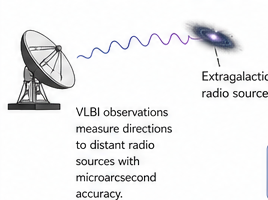

*Figure 3. VLBI observations of extragalactic radio sources, illustrating realization and maintenance of the celestial frame.*

##### 2.4.4.5.1 Realization and maintenance

The IAU, through the IERS and ICRF Working Group, maintains and updates the ICRF. It lists the following successive realizations:

| Realization | Year | Approximate number of sources shown |
|---|---:|---:|
| ICRF1 | 1998 | 608 |
| ICRF2 | 2009 | 3,414 |
| ICRF3 | 2018 | 4,536 |

VLBI observations measure directions to distant radio sources with microarcsecond accuracy, providing the observational basis for the celestial frame.

#### 2.4.4.6. Relationship to other reference systems

The ICRF is related to three important standard frames:

- **BCRS:** ICRS orientation is aligned with the BCRS at J2000.0, stated as within approximately 0.1 milliarcseconds.
- **GCRS:** The Geocentric Celestial Reference System provides a related framework for applications near Earth.
- **ITRF:** The celestial system provides a counterpart to terrestrial reference frames, including the International Terrestrial Reference Frame.

For applications involving an Earth-fixed location and a spacecraft, positions must be brought into a common reference framework using separately defined transformations, time conventions, and Earth-orientation data.

#### 2.4.4.7. Relationship to time

Positions are given for a specified coordinate time. **Barycentric Coordinate Time (TCB)** is the coordinate time scale associated with the BCRS and ICRS.

It also shows:

- **Epoch J2000.0:** January 1.5, 2000, is expressed in Terrestrial Dynamical Time (TDB).
- **Proper motion:** For high-precision applications, positions must account for proper motion and parallax.
- **Epoch propagation:** Catalog positions may be propagated to other epochs using an appropriate motion model.

The time-line illustration in the source shows epochs J2000.0, 2100, 2200, and 2300 as an example of time-dependent propagation.

#### 2.4.4.8. Definitions

**ICRS — International Celestial Reference System:** A celestial reference system with its origin at the Solar System barycenter and axes defined by distant extragalactic sources.

**ICRF — International Celestial Reference Frame:** A catalog of radio sources realizing the orientation of the ICRS.

**Quasi-inertial:** Non-rotating with respect to distant extragalactic objects, subject to small residual apparent motions.

**TCB — Barycentric Coordinate Time:** The coordinate time scale associated with the barycentric reference system.

#### 2.4.4.9. Relevance to the linked frame conceptual model

The ICRS provides an example of an externally defined celestial reference system to which a local frame may be related. For example, a spacecraft antenna's local Euclidean frame can be oriented toward a target whose direction is determined using celestial navigation data.

The linked frame model represents the local frame and the existence of a transformation to another frame; celestial ephemerides, light-time calculations, reference-frame transformations, and other geometry-dependent computations are supplied by separate standards and implementations.

#### 2.4.4.10. Summary and editorial notes

The ICRS provides a stable orientation reference for precise celestial observations and navigation. Its realization through the ICRF makes it possible to relate measurements made at different places and times to a common celestial frame.

**Items to verify before publication:** the number and classification of sources in each ICRF realization; the exact meaning of the 0.1 mas alignment; the epoch and time-scale wording for J2000.0; and the distinction between the ICRS, its ICRF realization, and the BCRS coordinate framework.

## 3. Mathematical Foundations

### 3.1 Space, time, and spacetime

**TBD** Define the modeled physical domain, points versus events, time coordinates and proper time, and the distinctions among Newtonian, special-relativistic, and general-relativistic descriptions.

*Content goes here.*

### 3.2 Differentiable manifolds and coordinate charts

**TBD** Explain smooth manifolds, local coordinates, overlapping charts, and the distinction between coordinate neighborhoods and metric approximations.

*Content goes here.*

### 3.3 Tangent spaces and local bases

**TBD** Define tangent spaces, basis vectors, orthonormal frames, and the role of a chosen metric. Explain why local linearity does not imply global Euclidean geometry.

*Content goes here.*

**Equation placeholder:** Definitions of tangent vectors and local basis.

### 3.4 Metrics, connections, and geodesics

**TBD** Distinguish metrics from connections; introduce geodesics, parallel transport, and path dependence in curved spaces. Explain how these structures support comparisons between spatial frames at different points.

*Content goes here.*

### 3.5 Local spatial frames in relativistic spacetime

**TBD** Explain the observer-dependent spatial subspace at an event, its Euclidean inner product, and the additional observer/time information required for relativistic interpretation. Avoid treating a local frame as a complete 4D spacetime frame.

*Content goes here.*

### 3.6 Euclidean approximations and domains of validity

**TBD** Describe local Euclidean models, approximation error, spatial and temporal scale, curvature, and when Newtonian assumptions cease to be sufficient.

*Content goes here.*

**Figure placeholder:** Local tangent frames situated within a curved manifold.

## 4. Conceptual Model

### 4.1 Conceptual design principles

**TBD** State simplicity, locality, implementation independence, explicit reference context, interoperability, and separation of representation from transformation.

*Content goes here.*

### 4.2 Space, event, position, and local frame

**TBD** Define the core entities and relationships, including the difference between a point in space and an event in spacetime.

*Content goes here.*

### 4.3 Orientation and the local orthonormal triad

**TBD** Define orientation of a 3D spatial frame. Distinguish a single pointing direction from a complete three-axis orientation; specify handedness and orientation conventions.

*Content goes here.*

### 4.4 Definition of a local frame

A local frame defines a local Euclidean spatial reference frame at a point in space or at an event in spacetime. Its orientation may be established relative to another reference frame using locally defined directions, including tangents to geodesics. The mathematical operations required to relate the frames depend on the geometry of the containing space or spacetime. A complete orientation requires sufficient independent constraints to determine all three rotational degrees of freedom.

There are three distinct concepts:

1. **The local spatial frame**.
2. Geometric relationship: The mathematical relationship between points, events, directions, and frames.
3. Frame transformation: The operation that establishes the position and orientation of one frame relative to another.
There is one further subtlety: in curved space, comparing orientations at different points generally requires parallel transport along a specified path. Different paths may produce different orientations because of curvature. This is a property of the geometry, not a limitation of the frame representation.

### 4.5 Reference frame and reference context

**TBD:** Distinguish the represented local frame, the containing geometry, the external reference frame, and associated epoch or observer information where needed.

*Content goes here.*

### 4.6 Core concept dictionary

**TBD** Provide concise definitions for Space, Spacetime, Event, Point, Position, Direction, Orientation, Local Frame, Reference Frame,  Metric, Connection, Geodesic, and Transformation. Keep the exhaustive dictionary in an appendix or companion standards document.

*Content goes here.*

### 4.7 UML conceptual model and constraints

**TBD** Present Enterprise Architect UML class diagrams, associations, multiplicities, invariants, and any optional extensions. Identify which concepts are core and which belong to supporting geometry.

*Content goes here.*

**Figure placeholder:** Core frame graph UML conceptual model.

## 5. Representations of Position and Orientation

### 5.1 Coordinate representations of position

**TBD** Compare Cartesian, geodetic ellipsoidal, and local tangent-plane coordinates. Explain representation equivalence within an explicitly specified CRS and domain.

*Content goes here.*

### 5.2 Orientation representations

**TBD** Compare rotation matrices, Euler/yaw-pitch-roll angles, axis-angle, and unit quaternions, including conventions, ambiguities, and singularities.

*Content goes here.*

### 5.3 Rigid transformations in Euclidean space

SO(3) and SE(3) are mathematical tools for relating local frames. 
**TBD** Explain composition and inversion without prescribing a transformation API.

**Equation placeholder:** Homogeneous rigid transformation and composition.

### 5.4 Frame specification versus serialized data structure

**TBD** Separate conceptual properties from encodings and implementation-specific data types. Discuss backward compatibility with GeoPose 1.0 as a design objective requiring demonstration.

*Content goes here.*

## 6. Relating Linked Frames in Geometric Contexts

### 6.1 Relationship between two local frames

**TBD** Identify the geometric information required to compare positions and orientations, including reference frame, epoch, observer, and connection/path when relevant.

*Content goes here.*

### 6.2 Direction from a geodesic

**TBD** Explain how a geodesic tangent defines a local direction, why a single direction does not fix roll about that direction, and which additional convention determines full orientation.

*Content goes here.*

### 6.3 Parallel transport and curved-space comparison

**TBD** Discuss transport of basis vectors, holonomy, path dependence, and implications for remote-frame orientation comparisons.

*Content goes here.*

### 6.4 Terrestrial and celestial reference-frame relationships

**TBD** Identify the information needed to relate Earth-fixed and celestial frames, including epochs, Earth orientation, and applicable physical models. Refer transformation methods to external standards and implementations.

*Content goes here.*

### 6.5 Scope of the model

Transformation algorithms, ephemeris computation, Earth-orientation models, and relativistic propagation calculations are outside the proposed conceptual standard. 

## 7. Quality, Uncertainty, and Confidence

### 7.1 Quality concepts and terminology

**TBD** Distinguish resolution, accuracy, precision, error, uncertainty, bias, and confidence. Reconcile definitions with authoritative metrology and geospatial quality literature.

*Content goes here.*

### 7.2 Position uncertainty

**TBD** Describe component uncertainty, covariance, error ellipsoids, confidence regions, and frame-dependent interpretation.

*Content goes here.*

### 7.3 Orientation uncertainty

**TBD** Discuss uncertainty on SO(3), small-angle perturbations, local tangent representations, and limitations of independent Euler-angle error values.

*Content goes here.*

### 7.4 Joint pose uncertainty and correlation

**TBD** Explain coupled position/orientation uncertainty and how it may be represented locally. Discuss transformation propagation as an external operation.

*Content goes here.*

### 7.5 Quality metadata and naming conventions

**TBD** Explain metadata.

*Content goes here.*

## 6.Componentization

**TBD** Describe components and how they may be combined to form a frame graph.
**TBD** Evaluate the proposed parameter-quality naming pattern (e.g., positionResolution, positionBias). Distinguish conceptual quality from a chosen serialization.

*Content goes here.*

### 7.6 Semantic identity and confidence (optional extension)

Visual-positioning applications may attach identity and semantic predictions to features. Make clear that categorical confidence is distinct from geometric measurement uncertainty and is outside the core.

## 8. Worked Examples and Use Cases

These examples illustrate the use of linked frames in complex configurations at large distances and in complex states of relative motion.

### 8.1. Pointing a Spacecraft Antenna Toward a Terrestrial Target

This example describes computing a local frame for a spacecraft antenna, such as one on Voyager 1, directed toward a fixed terrestrial target. It is an illustrative conceptual example, not an operational pointing solution.

#### 8.1.1. Specify the inputs

The objective is to compute a local frame specifying the position and orientation of an antenna mounted on a spacecraft so that its boresight points toward a specified terrestrial target at a given time.

#### 8.1.1.1 Ground target (ITRF2020)

The target is specified using geodetic latitude $\phi$, longitude $\lambda$, ellipsoidal height $h$ (with a defined geodetic conversion), or Earth-centered Cartesian coordinates $(X,Y,Z)$ in ITRF2020.

##### 8.1.1.2 Time

The requested pointing epoch is $t_{\mathrm{TAI}}$, for example `2026-01-01T00:00:00 TAI`.

#### 8.1.1.3 Spacecraft navigation data

- Spacecraft position $\mathbf r_{\mathrm{sc}}(t)$ in a specified inertial frame.
- Spacecraft attitude, as a rotation matrix or quaternion.
- Antenna mounting position relative to the spacecraft body frame.
- Antenna boresight direction in its local frame, for example $(0,0,1)$.

### 8.2. Establish reference frames

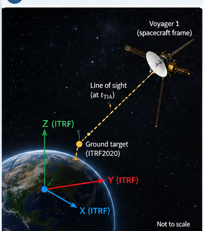

The calculation involves four reference frames:

1. **ITRF2020:** The terrestrial frame in which the ground target is specified.
2. **Celestial inertial frame:** A celestial frame aligned with ICRF, or another explicitly defined inertial frame, in which positions can be compared.
3. **Spacecraft body local frame:** A frame attached to the spacecraft, with attitude provided by navigation data.
4. **Antenna local frame:** A frame attached to the antenna, with its origin at a reference point and its $Z$-axis aligned with the boresight.

The ITRF2020-to-celestial transformation depends on time and Earth orientation parameters. The body-frame transformation depends on spacecraft attitude. These transformations are supplied by external standards and implementations, not by the  conceptual model.

### 8.3. Compute position and direction

#### 8.3.1. Target position in the celestial frame

Convert the terrestrial target coordinates to the selected celestial frame at epoch $t$:

$$
\mathbf r_T(t)=F_{\mathrm{ITRF}\rightarrow\mathrm{celestial}}(\mathbf r_{\mathrm{ITRF}},t).
$$

The transformation incorporates the applicable Earth orientation model.

#### 8.3.2. Spacecraft position

Obtain the spacecraft position at the same epoch:

$$
\mathbf r_{\mathrm{sc}}(t).
$$

Both position vectors must use the same coordinate frame and origin.

#### 8.3.3. Geometric line of sight

The approximate direction from spacecraft to target is:

$$
\mathbf v=\mathbf r_T(t)-\mathbf r_{\mathrm{sc}}(t),
\qquad
\hat{\mathbf u}=\frac{\mathbf v}{\|\mathbf v\|}.
$$

For operational deep-space uplinks or downlinks, transmission and reception events must be distinguished, signal propagation time accounted for, and spacecraft and Earth positions evaluated at the appropriate epochs. Relativistic corrections may also be needed.

### 8.4. Determine the required antenna orientation

#### 8.4.1. Express the direction in the spacecraft body frame

Let $R_{\mathrm{body}\rightarrow\mathrm{celestial}}$ describe the spacecraft body frame relative to the celestial frame. Then:

$$
\hat{\mathbf u}_{\mathrm{body}}=
R_{\mathrm{body}\rightarrow\mathrm{celestial}}^T\hat{\mathbf u}.
$$

#### 8.4.2. Compute the antenna rotation

Let $\mathbf b$ be the antenna boresight in its local frame. Find a rotation satisfying:

$$
R_{\mathrm{antenna}\rightarrow\mathrm{body}}\mathbf b
=\hat{\mathbf u}_{\mathrm{body}}.
$$

Alignment determines the pointing direction but leaves rotation about the boresight undetermined. A roll convention or mechanical constraint supplies the remaining orientation constraint. The complete rotation can be represented by a quaternion or matrix.

### 8.5. Define the antenna frame

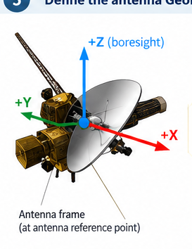

The antenna frame is a local spatial reference frame at the antenna reference point, with its local $Z$-axis aligned with the antenna boresight.

#### 8.5.1. Components

**Position:** The antenna reference point relative to the spacecraft body-frame origin, for example:

$$
\mathbf p_{\mathrm{antenna}}=
\begin{bmatrix}1.25\\0.00\\0.30\end{bmatrix}\ \mathrm{m}.
$$

**Orientation:** The rotation aligning the antenna local frame with the desired pointing direction, subject to the roll convention.

The complete rigid transformation is:

$$
T_{\mathrm{antenna}}=
\begin{bmatrix}
R_{\mathrm{antenna}\rightarrow\mathrm{body}} & \mathbf p_{\mathrm{antenna}}\\
0\quad0\quad0 & 1
\end{bmatrix}\in SE(3).
$$

The frame remains a six-degree-of-freedom local representation even when astronomical ephemerides and relativistic models are used to calculate the direction.

#### 8.5.2. Example numerical results (illustrative)

The original infographic provides these example values. They are **not** calculated from actual Voyager 1 navigation data.

| Input parameter | Illustrative value |
|---|---|
| Ground target | DSS-14, Goldstone |
| Latitude | 35.2472° |
| Longitude | −116.7933° |
| Height | 1,000 m |
| Time | 2026-01-01T00:00:00 TAI |
| Spacecraft position | $[1.2\times10^{13},-2.4\times10^{12},3.1\times10^{12}]$ m |
| Antenna boresight | $[0,0,1]$ |

| Computed quantity | Illustrative value |
|---|---|
| Target direction, inertial frame | $[-0.974,0.213,-0.072]$ |
| Target direction, body frame | $[0.021,-0.998,0.044]$ |
| Antenna orientation quaternion | $[0.707,0.031,-0.706,0.031]$ |
| Antenna position, body frame | $[1.25,0.00,0.30]$ m |

**Note and TBD** The illustrative directions and quaternion are not a mutually consistent numerical solution. Need to derive all values from one documented ephemeris, attitude, time convention, and frame-transformation pipeline.

### 8.6. Use of the Frame

The computed local frame specifies the antenna's local reference frame relative to the spacecraft body frame. It can support antenna pointing commands, subject to the spacecraft's mechanical configuration and capabilities, and can be combined with other linked frames representing the spacecraft and instruments.

**Central principle:** A frame provides a simple local Euclidean representation of position and orientation, while the operations needed to relate frames may involve Earth orientation, celestial mechanics, light propagation, and relativistic spacetime geometry.

The conceptual model defines the local representation and its meaning. Separate standards and implementations are responsible for the transformations used to calculate and relate linked frames.

The local frame can be used to support antenna pointing commands, subject to the spacecraft's actual mechanical configuration and pointing capabilities.

The antenna frame can also be linked with other frames representing the spacecraft, its instruments, and associated reference frames to form a larger spatial model.

The calculation demonstrates the central principle of the proposed conceptual model:

The frame is a simple local Euclidean representation of position and orientation, while the mathematical operations needed to establish relationships between frames may involve Earth orientation, celestial mechanics, light propagation, and relativistic spacetime geometry. The transformations used to calculate and relate frames remain the responsibility of separate standards and implementations.

### 8.2 Visual positioning of a camera

**TBD** Show how a camera pose estimated from observations, i.e. visual positionoing, is represented in a local frame, with separate treatment of matching algorithms and uncertainty.

### 8.2 Something else

**TBD** Show a third example, possibly the solarpose example or something from Hillyfields.

### 8.4 Comparison of examples across scales

**TBD** Demonstrate which  concepts remain unchanged and which contextual geometric/physical models vary across the three examples.

*Content goes here.*

## 9. Evaluation of the Conceptual Model

### 9.1 Evaluation criteria

**Write:** Define conceptual completeness, internal consistency, unambiguous frame semantics, interoperability, extensibility, and compatibility criteria.

*Content goes here.*

### 9.2 Competency questions

**TBD** Formulate questions the model must answer, such as: What frame is specified? Relative to what? At what time? Under which geometry? What information is needed for transformation? How is quality described?

*Content goes here.*

### 9.3 UML consistency and mathematical checks

**TBD** Identify invariants, dimensional consistency, frame-handedness, degrees of freedom, coordinate conventions, and test cases for ambiguous or incomplete specifications.

*Content goes here.*

### 9.4 Cross-domain application assessment

**TBD** Use the terrestrial, visual, and spacecraft examples to test generality while explicitly identifying where the conceptual model relies on external physics or transformation services.

*Content goes here.*

### 9.5 Limitations and open questions

**TBD** Address observer dependence, time representation, reference-frame realization, path dependence, quality representation, and any scope not yet rigorously validated.

*Content goes here.*

## 10. Implications for Standardization

### 10.1 Relationship to OGC GeoPose 1.0

**TBD** Identify proposed conceptual clarifications, additions, and potential compatibility issues. Separate evidence-backed compatibility from aspirational compatibility.

*Content goes here.*

### 10.2 Conceptual model versus normative encodings

**TBD** Explain why the model should remain implementation independent and how distinct serializations might conform to the same semantics.

*Content goes here.*

### 10.3 External transformation standards and implementations

**TBD** Specify the division of responsibility between linked frame concepts and separate reference-frame transformation specifications, software, ephemerides, and test suites.

*Content goes here.*

### 10.4 Conformance and interoperability considerations

**TBD** Propose future conceptual conformance questions without prematurely defining a normative conformance class or implementation test procedure.

*Content goes here.*

### 10.5 Future standardization roadmap

**TBD** Describe possible subsequent OGC/ISO work and reference implementations, without presenting the research paper as an approved standard.

*Content goes here.*

## 11. Conclusions and Future Work

### 11.1 Summary of findings

**TBD** Return to the central research question and summarize what the paper has actually established through formalization and evaluation.

*Content goes here.*

### 11.2 Future research

**TBD** Identify unresolved questions, including relativistic observer models, uncertainty propagation, transformation interoperability, and expanded visual-positioning use cases.

*Content goes here.*

## Acknowledgments

**TBD** Credit contributors, reviewers, working groups, and supporting organizations as appropriate; distinguish acknowledgment from authorship and institutional endorsement.

*Content goes here.*

## References

Euclidean space and classical reference frames

- Arnol'd, V.I. — Mathematical Methods of Classical Mechanics (Springer, 1978). The standard rigorous treatment of Newtonian mechanics, reference frames, and Galilean transformations from a geometric perspective.

- Goldstein, Poole & Safko — Classical Mechanics (3rd ed., Addison-Wesley, 2002). The standard graduate physics reference for frames, rigid body motion, and SE(3).

- Marsden & Ratiu — Introduction to Mechanics and Symmetry (Springer, 1999). Covers Lie groups including SE(3) and SO(3) rigorously, connecting classical mechanics to differential geometry.

Minkowski spacetime and Special Relativity

- Misner, Thorne & Wheeler — Gravitation (Princeton University Press, 1973, reissued 2017). Encyclopedic and authoritative. Chapters 1–6 cover special relativity, 4-vectors, and Minkowski geometry in depth. The standard graduate reference.

- Taylor & Wheeler — Spacetime Physics (2nd ed., Freeman, 1992). More accessible. Excellent for building geometric intuition about Minkowski spacetime, worldlines, and intervals.

- Naber — The Geometry of Minkowski Spacetime (Springer, 1992). Mathematically rigorous treatment of Minkowski space as a geometric object, covering the Lorentz group and causal structure carefully.

- Rindler — Relativity: Special, General, and Cosmological (2nd ed., Oxford, 2006). Clear and physically well-motivated, with strong treatment of frames and observers.

Pseudo-Riemannian spacetime and General Relativity

- Misner, Thorne & Wheeler — Gravitation (as above). Covers pseudo-Riemannian geometry, the equivalence principle, parallel transport, geodesics, and the Einstein equations thoroughly.
- Wald — General Relativity (University of Chicago Press, 1984). The most mathematically precise standard GR textbook. Particularly strong on differential geometry — manifolds, tensors, the Levi-Civita connection, and curvature are developed carefully.
- Hawking & Ellis — The Large Scale Structure of Space-Time (Cambridge, 1973). Rigorous treatment of global structure, causality, and singularity theorems on Lorentzian manifolds.
- O'Neill — Semi-Riemannian Geometry with Applications to Relativity (Academic Press, 1983). The most mathematically complete treatment of pseudo-Riemannian geometry specifically. Essential if you want the differential geometry done properly rather than via physicist shorthand.
- Carroll — Spacetime and Geometry: An Introduction to General Relativity (Addison-Wesley, 2004). More modern and pedagogically clear than Wald for a first pass. Good balance of mathematical rigor and physical intuition.

Reference frames specifically across all three domains

- Bolos, V.J. — "Intrinsic definitions of relative velocity in general relativity" (Communications in Mathematical Physics, 2007). A technical paper specifically addressing how relative velocity and reference frames are defined in curved spacetime, and how the flat-space definitions fail to generalize naively.
- Malament, D. — "Topics in the Foundations of General Relativity and Newtonian Gravitation Theory" (University of Chicago Press, 2012). Philosophically and mathematically careful treatment of what reference frames, simultaneity, and observers mean across the different spacetime models.
- Sachs & Wu — General Relativity for Mathematicians (Springer, 1977). Treats reference frames, observers, and the transition between Newtonian, special-relativistic, and general-relativistic settings from a unified mathematical viewpoint.

For spatial computing specifically

- [ITRF2005]Altamimi, Z.; Collilieux, X.; Legrand, J.; Garayt, B.; Boucher, C. (2007). "ITRF2005: A new release of the International Terrestrial Reference Frame based on time series of station positions and Earth Orientation Parameters". Journal of Geophysical Research: Solid Earth. 112 (B9): B09401. Bibcode:2007JGRB..112.9401A. doi:10.1029/2007JB004949. hdl:10338.dmlcz/141752.

There is no single canonical reference bridging spacetime geometry and spatial computing. OGC (Open Geospatial Consortium) Testbed 19 engineering reports are the most directly relevant applied documents. For the mathematical underpinnings of coordinate reference systems in geospatial contexts, ISO 19111 (Geographic information — Referencing by coordinates) is the relevant standard.

**TBD** Add verified scholarly and standards references with consistent citation keys. Prioritize OGC GeoPose 1.0, ISO 19111, relevant ISO quality standards, ITRF/ICRF technical documentation, differential geometry, rigid-body kinematics, and uncertainty/metrology sources. Do not treat the preliminary bibliography in the working draft as already verified.

## Appendix A. Extended Concept Dictionary

**TBD** Provide formal definitions and cross-references to the UML model. This may instead remain in the companion OGC conceptual model document.

*Content goes here.*

## Appendix B. Mathematical Conventions and Notation

**TBD** Specify manifold, metric, frame, coordinate, time-scale, rotation, and tensor conventions used throughout the paper.

*Content goes here.*

## Appendix C. Supplementary UML Diagrams

**TBD** Insert additional conceptual diagrams exported from Enterprise Architect and identify their authoritative model version.

*Content goes here.*

## Appendix D. Worked-Example Data and Reproducibility

**TBD** Provide assumptions, sample inputs, units, data provenance, external library versions, and calculations needed to reproduce the terrestrial and spacecraft examples.

*Content goes here.*

---

## Notes (remove before submission)

- **Primary argument:** linked frames are a simple local spatial-frame specification; differential geometry provides the general mathematical context in which such frames are interpreted and related.
- **Scope:** The conceptual model does not prescribe transformation algorithms or ephemeris computation.
- **Important distinction:** A 3D spatial frame in relativistic spacetime requires observer-related context; the frame and link alone are not a full 4D spacetime frame.
- **Important distinction:** A geodesic tangent provides a direction, not a full three-axis orientation. This is the same as a look-at pose specification in computer graphics. Another basis vector is needed, such as the "up" direction.
- **Spacecraft example:** Use **TAI** (International Atomic Time), not “TIA”; verify time-scale conversions required by ephemeris and Earth-orientation implementations.
- **Review checkpoints:** After completing Sections 1–4, request a conceptual/mathematical review. After Sections 5–8, request a representation and worked-example review. After Sections 9–11, request a publication-readiness review.
- 
