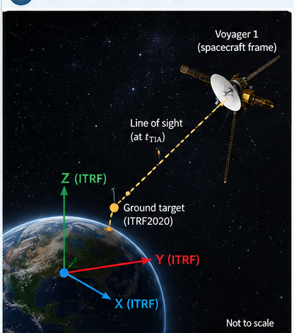
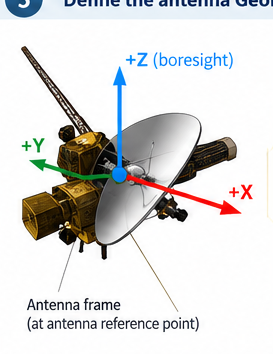

# Worked Example: Pointing a Spacecraft Antenna Toward a Terrestrial Target

This example describes computing a GeoPose for a spacecraft antenna, such as one on Voyager 1, directed toward a fixed terrestrial target. It is an illustrative conceptual example, not an operational pointing solution.

**Technical note:** The original infographic uses “TIA”; the internationally recognized time scale is **TAI (International Atomic Time)**. The simple line-of-sight calculation in Section 3 is a geometric approximation; accurate deep-space communication requires light-time and other corrections.

## 1. Specify the inputs

The objective is to compute a GeoPose specifying the position and orientation of an antenna mounted on a spacecraft so that its boresight points toward a specified terrestrial target at a given time.

### 1.1 Ground target (ITRF2020)

The target is specified using geodetic latitude $\phi$, longitude $\lambda$, ellipsoidal height $h$ (with a defined geodetic conversion), or Earth-centered Cartesian coordinates $(X,Y,Z)$ in ITRF2020.

### 1.2 Time

The requested pointing epoch is $t_{\mathrm{TAI}}$, for example `2026-01-01T00:00:00 TAI`.

### 1.3 Spacecraft navigation data

- Spacecraft position $\mathbf r_{\mathrm{sc}}(t)$ in a specified inertial frame.
- Spacecraft attitude, as a rotation matrix or quaternion.
- Antenna mounting position relative to the spacecraft body frame.
- Antenna boresight direction in its local frame, for example $(0,0,1)$.

## 2. Establish reference frames

The calculation involves four reference frames:

1. **ITRF2020:** The terrestrial frame in which the ground target is specified.
2. **Celestial inertial frame:** A celestial frame aligned with ICRF, or another explicitly defined inertial frame, in which positions can be compared.
3. **Spacecraft body frame:** A frame attached to the spacecraft, with attitude provided by navigation data.
4. **Antenna local frame:** A frame attached to the antenna, with its origin at a reference point and its $Z$-axis aligned with the boresight.

The ITRF2020-to-celestial transformation depends on time and Earth orientation parameters. The body-frame transformation depends on spacecraft attitude. These transformations are supplied by external standards and implementations, not by the GeoPose conceptual model.

## 3. Compute position and direction

### 3.1 Target position in the celestial frame

Convert the terrestrial target coordinates to the selected celestial frame at epoch $t$:

$$
\mathbf r_T(t)=F_{\mathrm{ITRF}\rightarrow\mathrm{celestial}}(\mathbf r_{\mathrm{ITRF}},t).
$$

The transformation incorporates the applicable Earth orientation model.

### 3.2 Spacecraft position

Obtain the spacecraft position at the same epoch:

$$
\mathbf r_{\mathrm{sc}}(t).
$$

Both position vectors must use the same coordinate frame and origin.

### 3.3 Geometric line of sight

The approximate direction from spacecraft to target is:

$$
\mathbf v=\mathbf r_T(t)-\mathbf r_{\mathrm{sc}}(t),
\qquad
\hat{\mathbf u}=\frac{\mathbf v}{\|\mathbf v\|}.
$$

For operational deep-space uplinks or downlinks, transmission and reception events must be distinguished, signal propagation time accounted for, and spacecraft and Earth positions evaluated at the appropriate epochs. Relativistic corrections may also be needed.

## 4. Determine the required antenna orientation

### 4.1 Express the direction in the spacecraft body frame

Let $R_{\mathrm{body}\rightarrow\mathrm{celestial}}$ describe the spacecraft body frame relative to the celestial frame. Then:

$$
\hat{\mathbf u}_{\mathrm{body}}=
R_{\mathrm{body}\rightarrow\mathrm{celestial}}^T\hat{\mathbf u}.
$$

### 4.2 Compute the antenna rotation

Let $\mathbf b$ be the antenna boresight in its local frame. Find a rotation satisfying:

$$
R_{\mathrm{antenna}\rightarrow\mathrm{body}}\mathbf b
=\hat{\mathbf u}_{\mathrm{body}}.
$$

Alignment determines the pointing direction but leaves rotation about the boresight undetermined. A roll convention or mechanical constraint supplies the remaining orientation constraint. The complete rotation can be represented by a quaternion or matrix.

## 5. Define the antenna GeoPose

The antenna GeoPose specifies a local spatial reference frame at the antenna reference point, with its local $Z$-axis aligned with the antenna boresight.

### 5.1 GeoPose components

**Position:** The antenna reference point relative to the spacecraft body-frame origin, for example:

$$
\mathbf p_{\mathrm{antenna}}=
\begin{bmatrix}1.25\\0.00\\0.30\end{bmatrix}\ \mathrm{m}.
$$

**Orientation:** The rotation aligning the antenna local frame with the desired pointing direction, subject to the roll convention.

The complete rigid transformation is:

$$
T_{\mathrm{antenna}}=
\begin{bmatrix}
R_{\mathrm{antenna}\rightarrow\mathrm{body}} & \mathbf p_{\mathrm{antenna}}\\
0\quad0\quad0 & 1
\end{bmatrix}\in SE(3).
$$

The GeoPose remains a six-degree-of-freedom local representation even when astronomical ephemerides and relativistic models are used to calculate the direction.

## 6. Example numerical results (illustrative)

The original infographic provides these example values. They are **not** calculated from actual Voyager 1 navigation data.

| Input parameter | Illustrative value |
|---|---|
| Ground target | DSS-14, Goldstone |
| Latitude | 35.2472° |
| Longitude | −116.7933° |
| Height | 1,000 m |
| Time | 2026-01-01T00:00:00 TAI |
| Spacecraft position | $[1.2\times10^{13},-2.4\times10^{12},3.1\times10^{12}]$ m |
| Antenna boresight | $[0,0,1]$ |

| Computed quantity | Illustrative value |
|---|---|
| Target direction, inertial frame | $[-0.974,0.213,-0.072]$ |
| Target direction, body frame | $[0.021,-0.998,0.044]$ |
| Antenna orientation quaternion | $[0.707,0.031,-0.706,0.031]$ |
| Antenna position, body frame | $[1.25,0.00,0.30]$ m |

**Validation caveat:** The illustrative directions and quaternion have not been shown to form a mutually consistent numerical solution. A publication-quality example should derive all values from one documented ephemeris, attitude, time convention, and frame-transformation pipeline.

## 7. Use of the GeoPose

The computed GeoPose specifies the antenna's local reference frame relative to the spacecraft body frame. It can support antenna pointing commands, subject to the spacecraft's mechanical configuration and capabilities, and can be combined with other GeoPoses representing the spacecraft and instruments.

**Central principle:** A GeoPose provides a simple local Euclidean representation of position and orientation, while the operations needed to relate frames may involve Earth orientation, celestial mechanics, light propagation, and relativistic spacetime geometry.

The GeoPose conceptual model defines the local representation and its meaning. Separate standards and implementations are responsible for the transformations used to calculate and relate GeoPoses.
