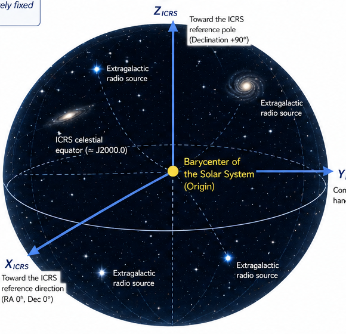
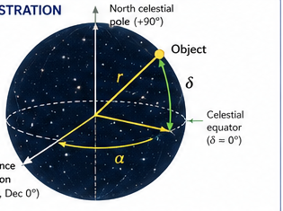
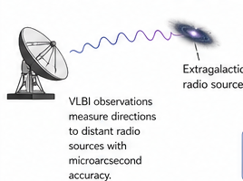

# International Celestial Reference System (ICRS)

*Fundamental celestial reference system adopted by the International Astronomical Union (IAU) in 1998.*

> **Source:** Transcription and reorganization of the supplied ICRS infographic. The images below are cropped from that infographic. Numerical and historical statements are preserved as presented and have not been independently verified.

## 1. Overview

The **International Celestial Reference System (ICRS)** is a quasi-inertial celestial reference system realized by extragalactic radio sources whose positions and proper motions are effectively fixed by their great distances.

The ICRS provides a stable, fundamental reference for modern astrometry, spacecraft navigation, and geodesy.

## 2. Key features

| Property | Description |
|---|---|
| Origin | Barycenter of the Solar System, consistent with the Barycentric Celestial Reference System (BCRS) |
| Orientation | Defined by distant extragalactic radio sources; approximately aligned with the BCRS axes at epoch J2000.0 |
| Nature | Quasi-inertial; non-rotating with respect to distant extragalactic objects |
| Realization | International Celestial Reference Frame (ICRF) |
| Time scale | Barycentric Coordinate Time (TCB) |
| Uses | Precise astrometry, spacecraft navigation, and geodesy |

## 3. Coordinate system and axes

The infographic depicts the ICRS using a right-handed Cartesian coordinate system with origin at the Solar System barycenter and axes approximately aligned with those of the BCRS at J2000.0.

*Figure 1. ICRS axes, Solar System barycenter, celestial equator, and extragalactic reference sources (cropped from supplied infographic).*

- **X axis:** Toward the ICRS reference direction at right ascension (RA) 0°, declination (Dec) 0°.
- **Y axis:** Completes the right-handed system.
- **Z axis:** Toward the ICRS reference pole, declination +90°.

The source notes that the ICRS axes are approximately aligned with the BCRS axes at J2000.0.

## 4. Spherical celestial coordinates

A direction or location can be described using spherical coordinates:

- **Right ascension (α):** Angular coordinate along the celestial equator from the reference direction.
- **Declination (δ):** Angle north (+) or south (−) of the equatorial plane.
- **Distance (r):** Radial distance from the origin, when applicable.

*Figure 2. Celestial sphere illustration showing right ascension α, declination δ, and distance r (cropped from supplied infographic).*

For a point with finite distance, the corresponding Cartesian coordinates may be expressed as:

$$
\begin{aligned}
X &= r\cos\delta\cos\alpha,\\
Y &= r\cos\delta\sin\alpha,\\
Z &= r\sin\delta.
\end{aligned}
$$

*The equations are an explanatory mathematical expansion of the coordinate labels in the source, rather than a transcription of equations shown in the image.*

## 5. Realization: International Celestial Reference Frame (ICRF)

The **ICRF** is the realization of the ICRS through a catalog of compact extragalactic radio sources observed using **Very Long Baseline Interferometry (VLBI)**.

The supplied infographic states:

- **ICRF3 (2018):** 4,536 defining sources.
- Optical reference frames can be related through small orientation offsets.

*Figure 3. VLBI observations of extragalactic radio sources, illustrating realization and maintenance of the celestial frame (cropped from supplied infographic).*

### 5.1 Realization and maintenance

According to the infographic, the IAU, through the IERS and ICRF Working Group, maintains and updates the ICRF. It lists the following successive realizations:

| Realization | Year | Approximate number of sources shown |
|---|---:|---:|
| ICRF1 | 1998 | 608 |
| ICRF2 | 2009 | 3,414 |
| ICRF3 | 2018 | 4,536 |

VLBI observations measure directions to distant radio sources with microarcsecond accuracy, providing the observational basis for the celestial frame.

## 6. Relationship to other reference systems

The supplied infographic identifies these relationships:

- **BCRS:** ICRS orientation is aligned with the BCRS at J2000.0, stated as within approximately 0.1 milliarcseconds.
- **GCRS:** The Geocentric Celestial Reference System provides a related framework for applications near Earth.
- **ITRF:** The celestial system provides a counterpart to terrestrial reference frames, including the International Terrestrial Reference Frame.

For applications involving an Earth-fixed location and a spacecraft, positions must be brought into a common reference framework using separately defined transformations, time conventions, and Earth-orientation data.

## 7. Relationship to time

Positions are given for a specified coordinate time. The infographic identifies **Barycentric Coordinate Time (TCB)** as the coordinate time scale associated with the BCRS and ICRS.

It also shows:

- **Epoch J2000.0:** January 1.5, 2000, expressed in Terrestrial Dynamical Time (TDB) in the infographic.
- **Proper motion:** For high-precision applications, positions must account for proper motion and parallax.
- **Epoch propagation:** Catalog positions may be propagated to other epochs using an appropriate motion model.

The time-line illustration in the source shows epochs J2000.0, 2100, 2200, and 2300 as an example of time-dependent propagation.

## 8. Definitions

**ICRS — International Celestial Reference System:** A celestial reference system with its origin at the Solar System barycenter and axes defined by distant extragalactic sources.

**ICRF — International Celestial Reference Frame:** A catalog of radio sources realizing the orientation of the ICRS.

**Quasi-inertial:** Non-rotating with respect to distant extragalactic objects, subject to small residual apparent motions.

**TCB — Barycentric Coordinate Time:** The coordinate time scale associated with the barycentric reference system.

## 9. Relevance to the GeoPose conceptual model

The ICRS provides an example of an externally defined celestial reference system to which a local GeoPose may be related. For example, a spacecraft antenna's local Euclidean frame can be oriented toward a target whose direction is determined using celestial navigation data.

The GeoPose represents the local frame; celestial ephemerides, light-time calculations, reference-frame transformations, and other geometry-dependent computations are supplied by separate standards and implementations.

## 10. Summary and editorial notes

The ICRS provides a stable orientation reference for precise celestial observations and navigation. Its realization through the ICRF makes it possible to relate measurements made at different places and times to a common celestial frame.

**Items to verify before scholarly publication:** the number and classification of sources in each ICRF realization; the exact meaning of the quoted 0.1 mas alignment; the epoch and time-scale wording for J2000.0; and the distinction between the ICRS, its ICRF realization, and the BCRS coordinate framework. These statements have been retained from the source image rather than independently checked.

---

*Source image: `ICRS.png`, supplied by the author. Figures are cropped from that image.*
