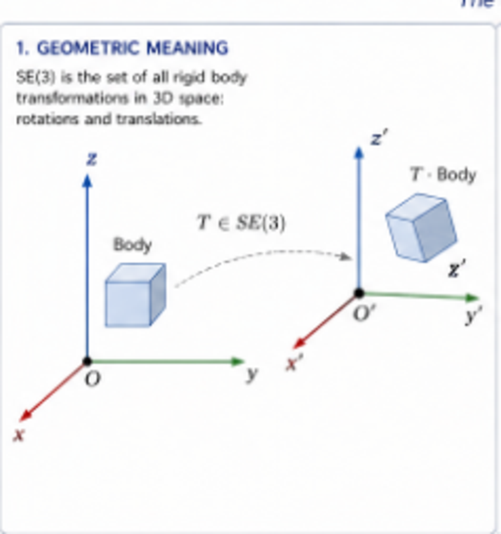
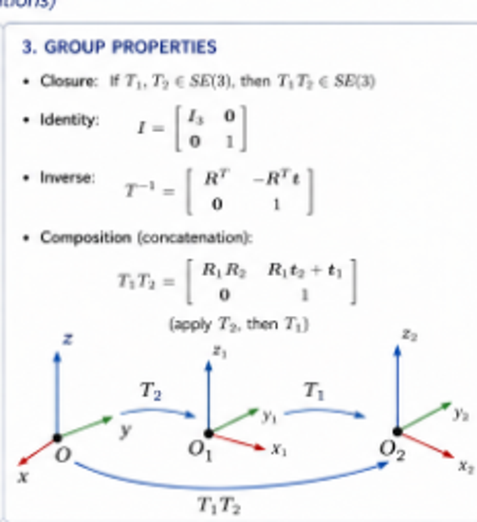
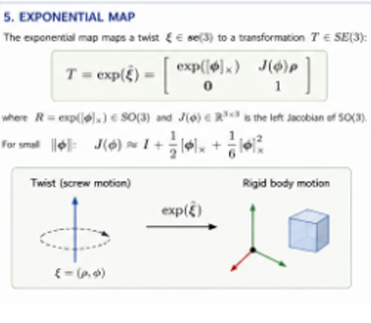

# The 3D Special Euclidean Lie Group SE(3)

*The group of 3D rigid-body motions (rotations and translations)*

> Source: transcription and restructuring of the supplied SE(3) infographic. Figures are cropped from that infographic. Equations use LaTeX for Markdown rendering.

## 1. Geometric Meaning

SE(3) is the set of all rigid-body transformations in three-dimensional space: rotations and translations.

A transformation \(T\in SE(3)\) maps points expressed in one Cartesian frame to points expressed in another. A rigid transformation preserves distances and angles.

*Figure 1. A body is moved from an initial coordinate frame to a translated and rotated frame.*

## 2. Matrix Representation

Each element \(T\in SE(3)\) can be written as a \(4\times4\) homogeneous transformation matrix:

$$
T=\begin{bmatrix}R&t\\\mathbf{0}_{1\times3}&1\end{bmatrix}
$$

where:

- \(R\in SO(3)\) is a rotation matrix, satisfying \(R^TR=I\) and \(\det R=1\).
- \(t\in\mathbb{R}^3\) is a translation vector.
- \(\mathbf{0}_{1\times3}=[0\;0\;0]\).

### Example: Rotation about the Z-axis

$$
R=R_z(\theta)=\begin{bmatrix}
\cos\theta&-\sin\theta&0\\
\sin\theta&\cos\theta&0\\
0&0&1
\end{bmatrix},\qquad
 t=\begin{bmatrix}t_x\\t_y\\t_z\end{bmatrix}.
$$

### Numerical example

For \(\theta=30^\circ\) and \(t=[1\;2\;3]^T\),

$$
T\approx\begin{bmatrix}
0.866&-0.500&0&1\\
0.500&0.866&0&2\\
0&0&1&3\\
0&0&0&1
\end{bmatrix}.
$$

## 3. Group Properties

The transformations in SE(3) form a group under matrix multiplication.

### Closure

If \(T_1,T_2\in SE(3)\), then \(T_1T_2\in SE(3)\).

### Identity

$$
I_4=\begin{bmatrix}I_3&0\\0&1\end{bmatrix}.
$$

### Inverse

For \(T=\begin{bmatrix}R&t\\0&1\end{bmatrix}\),

$$
T^{-1}=\begin{bmatrix}R^T&-R^Tt\\0&1\end{bmatrix}.
$$

### Composition (concatenation)

If

$$
T_1=\begin{bmatrix}R_1&t_1\\0&1\end{bmatrix},\quad
T_2=\begin{bmatrix}R_2&t_2\\0&1\end{bmatrix},
$$

then

$$
T_1T_2=\begin{bmatrix}R_1R_2&R_1t_2+t_1\\0&1\end{bmatrix}.
$$

With the column-vector convention used here, \(T_1T_2\) applies \(T_2\) first and then \(T_1\).

*Figure 2. Composition of rigid transformations. Frame labels and composition order must follow a consistent convention.*

## 4. Lie Group Structure

SE(3) is a six-dimensional smooth manifold and a Lie group. Its Lie algebra \(\mathfrak{se}(3)\), the tangent space at the identity, consists of twists \(\xi\in\mathbb{R}^6\) written as

$$
\xi=\begin{bmatrix}\rho\\\phi\end{bmatrix},\qquad
\rho,\phi\in\mathbb{R}^3.
$$

The associated matrix representation (the **hat** operator) is

$$
\widehat{\xi}=\begin{bmatrix}
[\phi]_\times&\rho\\
\mathbf{0}_{1\times3}&0
\end{bmatrix}\in\mathfrak{se}(3),
$$

where

$$
[\phi]_\times=\begin{bmatrix}
0&-\phi_z&\phi_y\\
\phi_z&0&-\phi_x\\
-\phi_y&\phi_x&0
\end{bmatrix}.
$$

The dimension is

$$
\dim SE(3)=6\qquad\text{(3 rotational + 3 translational degrees of freedom).}
$$

## 5. Exponential Map

The exponential map maps a twist \(\xi\in\mathfrak{se}(3)\) to a rigid transformation \(T\in SE(3)\):

$$
T=\exp(\widehat{\xi})=
\begin{bmatrix}
\exp([\phi]_\times)&J(\phi)\rho\\
0&1
\end{bmatrix},
$$

where \(R=\exp([\phi]_\times)\in SO(3)\) and \(J(\phi)\) is the left Jacobian of SO(3).

For small \(\|\phi\|\), the infographic gives the series approximation

$$
J(\phi)\approx I+\frac12[\phi]_\times+\frac16[\phi]_\times^2.
$$

*Figure 3. The exponential map associates a twist with a rigid-body transformation.*

## 6. Applications

SE(3) is used in:

- **Robotics:** End-effector pose and kinematics.
- **Computer vision:** Camera pose and simultaneous localization and mapping (SLAM).
- **State estimation:** Estimation and optimization on manifolds.
- **Rigid-body registration and calibration:** Alignment of objects, sensors, and coordinate frames.

### Summary

$$
SE(3)=\left\{\begin{bmatrix}R&t\\0&1\end{bmatrix}\;\middle|\;R\in SO(3),\ t\in\mathbb{R}^3\right\}.
$$

SE(3) is the mathematical backbone of three-dimensional pose representation and rigid-body motion.

### Relevance to GeoPose

SE(3) provides a natural mathematical representation for the six-degree-of-freedom relationship between two Euclidean spatial frames. For the proposed GeoPose conceptual model, this representation is particularly appropriate within a local tangent space or another specified Euclidean spatial region. Relating such frames across a curved manifold may require additional geometric structures and transformation procedures external to the GeoPose representation.

---

**Editorial note:** The infographic's mathematical content has been transcribed into standard notation. The numerical matrix is shown with rounded entries. The exact interpretation of a frame transformation depends on the adopted active/passive and source/target frame conventions, which should be specified in the research paper.
