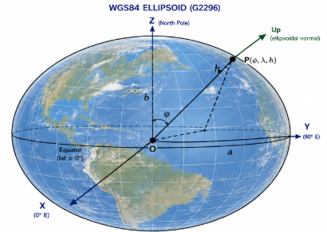
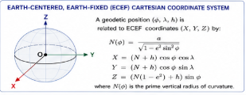
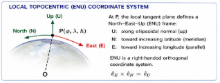

# WGS84 G2296 Geodetic Reference System

*Official realization of WGS 84 (G2296) as defined by the National Geospatial-Intelligence Agency (NGA).*

A precise, global, Earth-centered reference system for position, navigation, and timing.

> **Source and scope.** This document transcribes and reorganizes the supplied infographic into editable Markdown, with three cropped illustrations from that image. Values and statements are presented as they appear in the source; this is not an independent verification of NGA specifications. Some tiny numeric labels in the original image are difficult to resolve and are flagged below rather than guessed.

## 1. Overview

- WGS84 G2296 is presented as the current official realization of the WGS 84 geodetic reference system.
- It defines the origin, scale, orientation, and gravity-related quantities consistent with global positioning systems (GPS).
- It is used worldwide for navigation, surveying, mapping, and geodesy.

## 2. Reference Frame (G2296)

- **Type:** Earth-centered, Earth-fixed (ECEF).
- **Origin:** Earth's center of mass (geocenter).
- **Orientation:** Aligned with the International Terrestrial Reference Frame (ITRF).
- **Scale:** Consistent with the SI meter.
- **Realization epoch:** 2017.0 (as labeled in the infographic).
- **Time scale:** Coordinated Universal Time (UTC) (as labeled in the infographic).
- **Updated and maintained by:** NGA.

## 3. WGS84 Ellipsoid (G2296)

The reference ellipsoid defines the shape used for geodetic latitude, longitude, and ellipsoidal height.

| Parameter | Symbol | Value shown in image |
|---|---|---|
| Semi-major axis | $a$ | 6,378,137.0 m |
| Flattening | $f$ | $1/298.257223563$ |
| Semi-minor axis | $b$ | 6,356,752.314245 m |
| First eccentricity squared | $e^2$ | approximately 0.00669437999014 |
| Second eccentricity squared | $e'^2$ | approximately 0.00673949674228 |

The diagram shows the geocenter $O$, ellipsoid semi-axes $a$ and $b$, and a point $P(\phi,\lambda,h)$ above the reference ellipsoid. The **Up** direction follows the ellipsoid normal at the reference position.

## 4. Geodetic Coordinates

A position on or near Earth is specified by:

- $\phi$: geodetic latitude, from $-90^\circ$ to $+90^\circ$.
- $\lambda$: geodetic longitude, from $-180^\circ$ to $+180^\circ$.
- $h$: ellipsoidal height, in meters.

The ellipsoidal normal (**Up**) is perpendicular to the ellipsoid at the geodetic point.

## 5. Earth-Centered, Earth-Fixed Cartesian Coordinate System

A geodetic position $(\phi,\lambda,h)$ is converted to ECEF Cartesian coordinates $(X,Y,Z)$ by:

$$
N(\phi)=\frac{a}{\sqrt{1-e^2\sin^2\phi}}
$$

$$
X=(N(\phi)+h)\cos\phi\cos\lambda
$$

$$
Y=(N(\phi)+h)\cos\phi\sin\lambda
$$

$$
Z=(N(\phi)(1-e^2)+h)\sin\phi
$$

where $N(\phi)$ is the prime vertical radius of curvature, $a$ is the ellipsoid semi-major axis, and $e^2$ is the first eccentricity squared.

## 6. Local Topocentric (ENU) Coordinate System

At a selected geodetic position $P(\phi_0,\lambda_0,h_0)$, define a local **East–North–Up (ENU)** Cartesian frame:

- **Up (U):** Along the ellipsoidal normal, outward.
- **North (N):** Tangent to the meridian in the direction of increasing latitude.
- **East (E):** Tangent to the parallel in the direction of increasing longitude.

The ENU frame is right-handed:

$$\hat{\mathbf e}_E\times\hat{\mathbf e}_N=\hat{\mathbf e}_U.$$

This local frame is useful for representing a GeoPose relative to a terrestrial reference position.

## 7. Relationship to ITRF2020

The infographic states that **WGS84 G2296 is aligned with the International Terrestrial Reference Frame 2020 (ITRF2020)**.

It describes the origin, orientation, and scale of WGS84 G2296 as consistent with ITRF2020 at the stated realization epoch, and gives a schematic epoch-dependent relation:

$$
\mathbf X_{\mathrm{WGS84}}(t)
\approx
\mathbf X_{\mathrm{ITRF2020}}(t_0)
+\mathbf V\,(t-t_0)
$$

where $\mathbf V$ is a station or point velocity and $t_0$ is a reference epoch. This is a simplified relation from the infographic, **not** a complete transformation specification. The image also refers readers to NGA STND 0036 for details.

> **Editorial verification needed:** The infographic uses both the G2296 label and epoch 2017.0, and separately mentions ITRF2020. Verify the exact realization epoch, alignment accuracy, and reference-frame transformation details against authoritative NGA/ITRF documentation before publication.

## 8. WGS84 G2296 Parameters Summary

| Parameter | Value shown or described |
|---|---|
| Reference system | WGS 84 (G2296) |
| Origin | Earth's center of mass |
| Reference frame | ITRF-compatible |
| Epoch | 2017.0 (source label; verify) |
| Scale | SI meter |
| Semi-major axis, $a$ | 6,378,137.0 m |
| Flattening, $f$ | $1/298.257223563$ |
| Gravity-related parameters | Included in original infographic; verify precise small-print values against NGA specification |
| Realization authority | NGA |
| Official name | WGS84 G2296 |

## 9. Summary

- WGS84 G2296 is presented as an official realization of the WGS 84 geodetic reference system.
- It is Earth-centered, Earth-fixed, and aligned with ITRF2020 according to the source image.
- The WGS84 ellipsoid defines the reference shape for geodetic latitude, longitude, and ellipsoidal height.
- Positions can be expressed using geodetic $(\phi,\lambda,h)$ or Cartesian $(X,Y,Z)$ coordinates.
- A local East–North–Up reference frame can be constructed at a selected geodetic point.
- WGS84 is widely used in GPS and global geospatial applications.

## 10. Relevance to the GeoPose Conceptual Model

The infographic illustrates how a single terrestrial reference system supports several coordinate representations and a locally defined spatial frame. In the GeoPose conceptual model, the ENU frame provides an example of a local Euclidean frame whose origin and orientation are specified relative to a larger, externally defined terrestrial frame.

The coordinate conversions and transformations are separate mathematical operations; they need not be defined by the GeoPose representation itself.

*This final section is explanatory context added for the GeoPose research paper; it is not a transcription of the infographic.*
